# Modelo entidad-relación · Portal SARLAFT

Sprint 1 · Base de datos. Motor: **MySQL 8.0** (InnoDB, `utf8mb4`, intercalación
`utf8mb4_es_0900_ai_ci`: no distingue mayúsculas ni tildes al buscar, pero sí la ñ).

**31 tablas · 54 llaves foráneas · 3 vistas · 5 disparadores**, en cinco áreas.
Probado en MySQL 8.0.46: estructura, datos de prueba y 17 reglas de integridad (que la base rechace lo que debe rechazar).

| Archivo | Qué hace |
|---|---|
| `00_reiniciar_desarrollo.sql` | Borra la base completa. Solo en desarrollo |
| `01_esquema.sql` | Crea la base, las tablas, las restricciones, los disparadores y las vistas |
| `02_catalogos.sql` | Catálogos, parámetros y la versión 1 de los dos cuestionarios |
| `03_datos_prueba.sql` | Datos ficticios: los mismos terceros que muestra la pantalla de inicio |
| `04_usuario_aplicacion.sql` | Crea el usuario de MySQL de la aplicación, sin permisos para alterar tablas |
| `mer/*.png`, `mer/*.svg` | Los diagramas de este documento como imagen |

## Cómo leer los diagramas

Notación de pata de gallo (Crow's foot):

| Símbolo en el extremo | Significa |
|---|---|
| `||` | exactamente uno |
| `o|` | cero o uno |
| `|{` | uno o muchos |
| `o{` | cero o muchos |
| línea punteada | relación lógica sin llave foránea |

En cada entidad: **PK** llave primaria, **FK** llave foránea, **UK** forma parte de
una restricción de unicidad. En los diagramas por área, las tablas que pertenecen
a otra área aparecen solo con sus llaves.

## Decisiones de diseño

1. **Modelo híbrido: datos estructurados + preguntas parametrizables.**
   Lo que se cruza, se calcula o se reporta tiene columnas propias con su tipo y
   sus llaves: ubicación, actividad CIIU, cifras financieras y todas las personas
   (representantes, accionistas, junta, beneficiarios finales, familiares PEP).
   Lo que la norma cambia con frecuencia (preguntas PEP, operaciones
   internacionales, activos virtuales, origen de fondos, declaraciones) vive en
   `preguntas` y `respuestas`. Así un cambio normativo se resuelve desde
   *Ajustes*, sin tocar código, y las cifras y personas se pueden consultar con
   SQL normal.

2. **Cuestionarios versionados.** Cada formulario guarda qué versión del
   cuestionario respondió (`formularios.cuestionario_id`). Cuando cambie la norma
   se publica una versión nueva; los formularios viejos conservan sus preguntas.
   Solo puede haber una versión publicada por tipo de persona (lo garantiza una
   columna calculada con índice único).

3. **Un formulario por tercero y periodo** (`UNIQUE tercero_id, periodo`). Los
   datos generales y financieros cuelgan del formulario, no del tercero: son lo
   que se declaró *en ese periodo* y sirven como evidencia aunque después cambien.

4. **Una sola tabla para todas las personas** (`personas_vinculadas`, con `rol`).
   Así una cédula se busca en un solo lugar para cruzarla con listas
   restrictivas, sin importar si aparece como accionista, representante o
   familiar. Las columnas que solo aplican a un rol aceptan nulos, y las reglas
   clave se validan con `CHECK` (participación entre 0 y 100, parentesco
   obligatorio para familiares, correo obligatorio para el firmante).

5. **Trazabilidad.** El historial de estados del formulario lo llena un
   disparador (la aplicación indica quién hizo el cambio con `SET @usuario_id`).
   La `auditoria` no admite `UPDATE` ni `DELETE`. Las consultas en listas copian
   el nombre y el documento consultados, para que la evidencia no cambie si la
   persona se corrige después.

6. **Seguridad y datos personales.** Contraseñas con bcrypt; códigos de un solo
   uso guardados como huella SHA-256, nunca en claro. Los PDF de soporte no van
   dentro de la base: se guarda la ruta, el tamaño y la huella SHA-256 para
   probar que el archivo no cambió. Las alertas y el número de ROS ante la UIAF
   son reservados: ninguna pantalla del tercero los consulta.

7. **Integridad en la base, no solo en la aplicación.** Además de las llaves
   foráneas: un tercero jurídico debe tener razón social y NIT con dígito de
   verificación; un formulario enviado debe tener radicado; uno aprobado o
   rechazado debe tener revisor y ya no cambia de estado; una alerta cerrada debe
   tener decisión; si el país es Colombia, el municipio es obligatorio.

### Normalización

El modelo está en tercera forma normal, con tres excepciones deliberadas:

- `terceros.nombre` es una columna **calculada** (razón social o nombres +
  apellidos) para buscar y ordenar rápido. La calcula MySQL; no se puede
  desincronizar.
- `consultas_listas.nombre_consultado` y `documento_consultado` repiten datos de
  la persona a propósito: son una fotografía de lo que se consultó (evidencia).
- `formulario_datos_generales` repite por periodo datos que podrían ser del
  tercero: es la declaración de ese año, no la ficha actual.

## Estados del formulario

| Desde | Acción | Hacia | Quién |
|---|---|---|---|
| (nuevo) | crear | `borrador` | tercero |
| `borrador` | firmar y enviar | `en_revision` | tercero |
| `en_revision` | devolver para corregir | `devuelto` | equipo |
| `devuelto` | corregir y reenviar | `en_revision` | tercero |
| `en_revision` | aprobar | `aprobado` | equipo |
| `en_revision` | rechazar | `rechazado` | equipo |

`aprobado` y `rechazado` son finales. Al aprobar se calcula `vence_en`
(hoy + `periodicidad_actualizacion_meses`); la vista `v_vencimientos` dice quién
está vigente, por vencer o vencido.

## Vista general

Núcleo del modelo, sin catálogos ni usuarios (están en los diagramas por área).

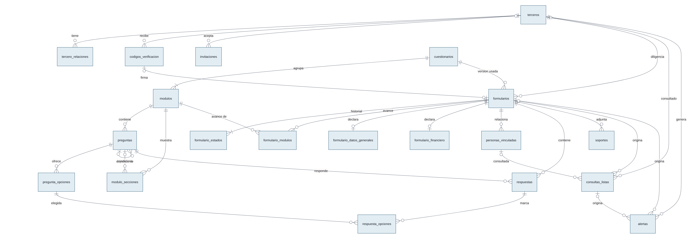

## 1. Personas y acceso

Quién entra al sistema. El equipo interno entra con usuario y contraseña (`usuarios`); los terceros, con su documento y un código de un solo uso (`codigos_verificacion`). Un tercero puede tener varias relaciones con la entidad a la vez.

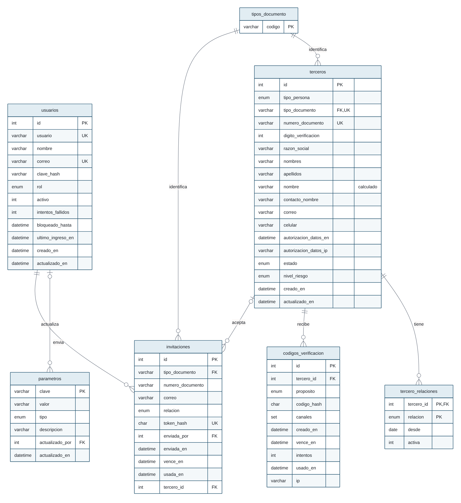

| Tabla | Columnas | Para qué sirve |
|---|---|---|
| `tipos_documento` | 4 | Tipos de documento de identidad aceptados |
| `usuarios` | 12 | Equipo interno: oficial de cumplimiento, analistas, auditores |
| `parametros` | 6 | Parametros editables desde Ajustes (periodicidad, tamanos, tiempos) |
| `terceros` | 18 | Proveedores, clientes, empleados, accionistas: quien diligencia el formulario |
| `tercero_relaciones` | 4 | Un tercero puede ser a la vez proveedor y cliente, etc. |
| `codigos_verificacion` | 10 | Codigos de un solo uso para entrar y para firmar |
| `invitaciones` | 11 | Enlaces que el equipo envia para que un tercero diligencie |

Código Mermaid del diagrama

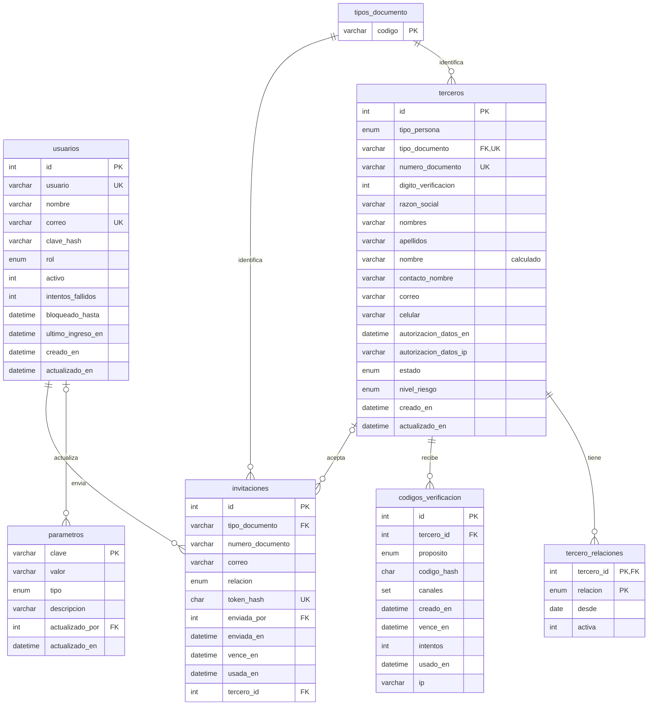

## 2. Cuestionario parametrizable

Lo que se le pregunta al tercero. Un cuestionario tiene módulos (los pasos del formulario); cada módulo tiene preguntas parametrizables y secciones fijas (bloques de datos estructurados, como la información financiera o la lista de accionistas). Una pregunta o sección puede depender de la respuesta a otra (`depende_de_pregunta_id` + `depende_de_valor`).

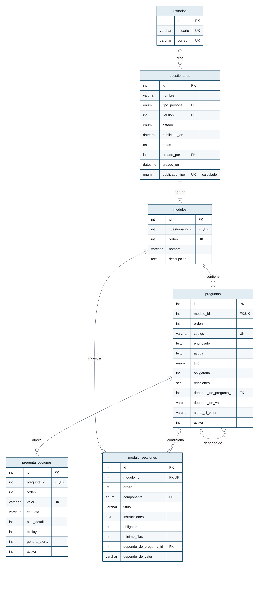

| Tabla | Columnas | Para qué sirve |
|---|---|---|
| `cuestionarios` | 10 | Versiones del formulario SARLAFT, una por tipo de persona |
| `modulos` | 5 | Pasos del formulario (Identificacion, PEP, Informacion financiera...) |
| `preguntas` | 13 | Preguntas de cada modulo |
| `pregunta_opciones` | 9 | Opciones de las preguntas de seleccion y multiples |
| `modulo_secciones` | 10 | Bloques fijos (datos generales, financiero, listas de personas) dentro de un modulo |

Código Mermaid del diagrama

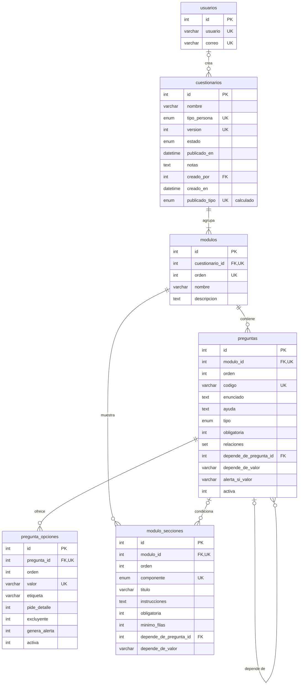

## 3. Formulario

Lo que diligencia el tercero cada periodo: sus respuestas, su avance por paso, sus documentos y la firma con código. `formulario_estados` es el historial de revisión.

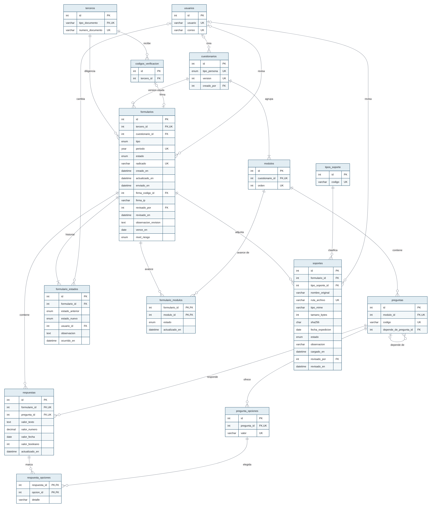

| Tabla | Columnas | Para qué sirve |
|---|---|---|
| `formularios` | 17 | Formulario SARLAFT de un tercero en un periodo |
| `formulario_estados` | 7 | Historial de cambios de estado (lo llena un disparador) |
| `formulario_modulos` | 4 | Avance por paso: lo que pinta la barra de pasos |
| `respuestas` | 8 | Respuesta a cada pregunta parametrizable. Las de seleccion guardan sus opciones en respuesta_opciones |
| `respuesta_opciones` | 3 | Opciones marcadas en preguntas de seleccion y multiples |
| `soportes` | 14 | Documentos adjuntos (RUT, camara de comercio, cedulas, estados financieros) |

Código Mermaid del diagrama

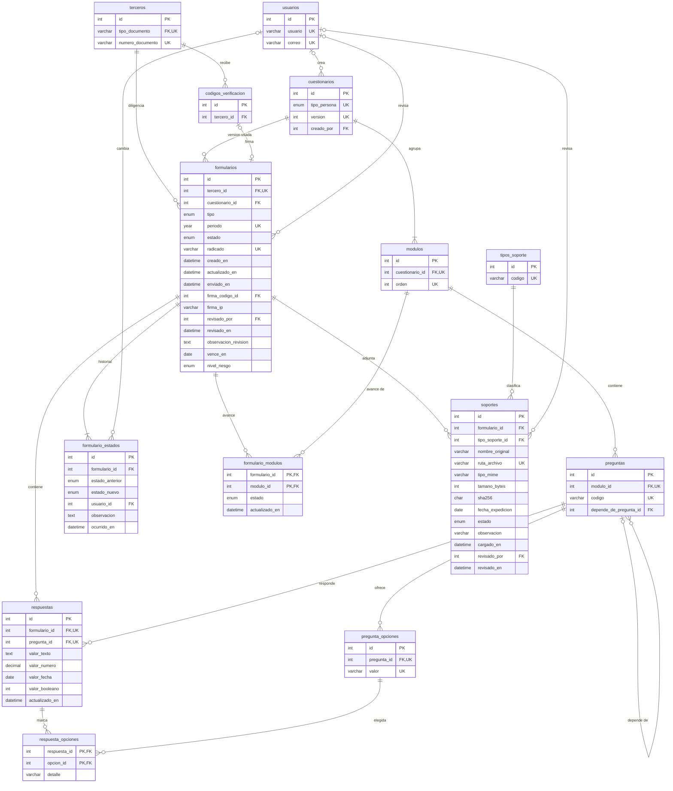

## 4. Datos declarados

Los datos estructurados del formulario y los catálogos oficiales en que se apoyan (DANE, ISO 3166, CIIU).

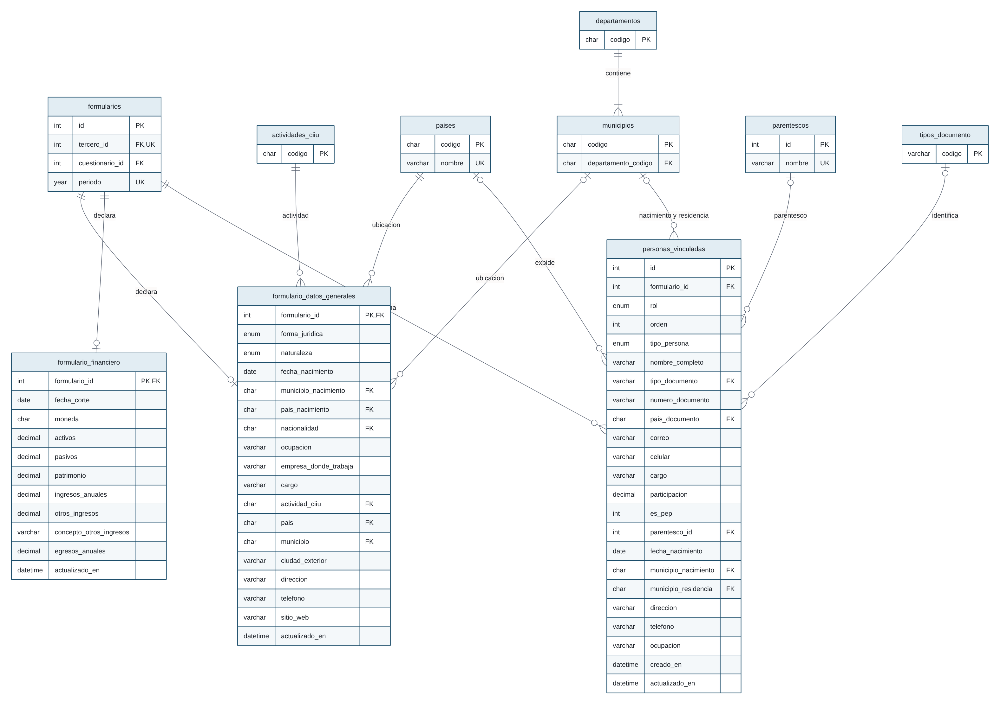

| Tabla | Columnas | Para qué sirve |
|---|---|---|
| `formulario_datos_generales` | 18 | Ubicacion, actividad economica y datos basicos declarados (1 a 1 con formulario) |
| `formulario_financiero` | 11 | Informacion financiera declarada (1 a 1 con formulario) |
| `personas_vinculadas` | 23 | Todas las personas que aparecen en el formulario: representantes, socios, junta, beneficiarios, familiares |
| `actividades_ciiu` | 3 | Actividades economicas CIIU |
| `paises` | 3 | Paises |
| `departamentos` | 2 | Departamentos de Colombia |
| `municipios` | 3 | Municipios de Colombia |
| `parentescos` | 4 | Parentescos para familiares de PEP y de directivos |

Código Mermaid del diagrama

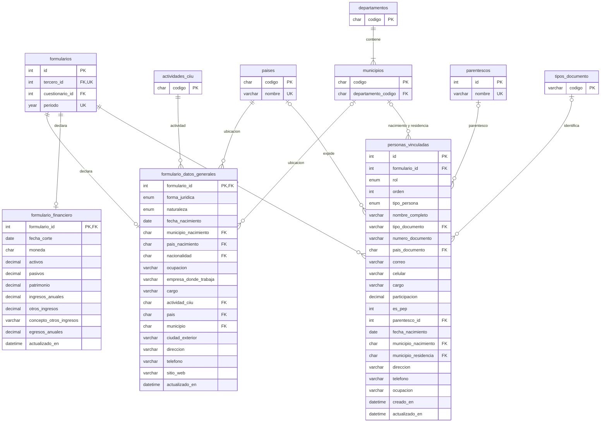

## 5. Control: listas, alertas y auditoria

El trabajo del oficial de cumplimiento: consultas en listas del tercero y de sus personas vinculadas, señales de alerta con su análisis y decisión, y la bitácora de todo lo que pasa en el sistema.

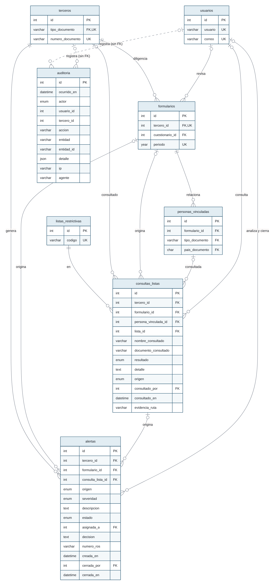

| Tabla | Columnas | Para qué sirve |
|---|---|---|
| `listas_restrictivas` | 6 | Listas restrictivas y de control que se consultan |
| `consultas_listas` | 13 | Cada consulta en listas restrictivas, del tercero o de sus personas vinculadas |
| `alertas` | 14 | Senales de alerta y su analisis. NUNCA visibles para el tercero (reserva del ROS) |
| `auditoria` | 11 | Bitacora de solo escritura: no admite UPDATE ni DELETE |

Código Mermaid del diagrama

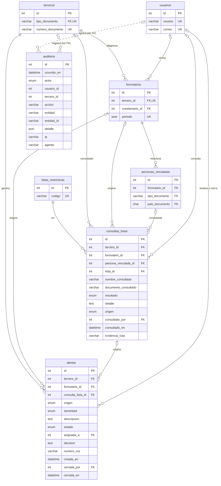

## Vistas

| Vista | Para qué |
|---|---|
| `v_bandeja_formularios` | Bandeja del equipo: formulario, tercero, documento, relaciones, estado, peor resultado en listas y alertas abiertas |
| `v_vencimientos` | Último formulario aprobado de cada tercero, días que le quedan y si está vigente, por vencer o vencido |
| `v_avance_formularios` | Pasos completos, con error y porcentaje de avance de cada formulario |

## Disparadores

| Disparador | Qué hace |
|---|---|
| `tr_formularios_historial_alta` y `_cambio` | Registran en `formulario_estados` cada cambio de estado, con el usuario de `@usuario_id` |
| `tr_formularios_cerrado` | Impide cambiar el estado de un formulario aprobado o rechazado |
| `tr_auditoria_sin_cambios` y `_sin_borrado` | La auditoría no se modifica ni se borra |

El detalle de cada columna está en los comentarios de `01_esquema.sql`; en MySQL
Workbench se ven en la pestaña de cada tabla, o con
`SHOW FULL COLUMNS FROM nombre_tabla;`.
